  

  
  

  
  
  

### ~/about

I'm Mohammad Sadra Naderi, a penetration tester and security researcher who also builds. I write full-stack web applications, automate the repetitive parts of security work, and study psychology seriously, because most systems are run by people.

I'm self-taught and I run **ZVitoX**, a small security and software team.

<table>
  <tr>
    <td valign="top" width="50%">
      <b>Penetration testing and research</b> 
      Web and API security 
      Bug bounty and vulnerability research 
      OSINT and reconnaissance 
      Network, wireless, Android and Windows testing 
      Red-team fundamentals
    </td>
    <td valign="top" width="50%">
      <b>Full-stack development</b> 
      Web apps in Python, PHP and JavaScript 
      Automation for recon and bug hunting 
      Scrapers and big-data pipelines 
      Telegram bots, admin panels, dashboards 
      Security tooling
    </td>
  </tr>
  <tr>
    <td valign="top" width="50%">
      <b>Psychology and persuasion</b> 
      Social engineering 
      Negotiation and persuasion 
      Body language and behavioral psychology 
      Business consulting
    </td>
    <td valign="top" width="50%">
      <b>Systems and data</b> 
      Linux administration 
      Apache and Nginx 
      MySQL, MongoDB, SQLite 
      Hosting and support
    </td>
  </tr>
</table>

### ~/stack

**Languages**

  
  
  
  
  
  

**Web**

  
  
  
  
  
  
  
  
  

**Systems and data**

  
  
  
  
  
  
  
  
  
  
  

**Learning now**

  
  

<b>Security toolkit</b> (and most of what ships with Kali)

 

  
  
  
  
  
  
  
  
  
  
  
  
  
  

### ~/how-i-work

1. Look at the people before the packets.
2. Recon is most of the job. The bug is usually the last ten percent.
3. Anything I do twice becomes a script.
4. If I found it, I write it down.

### ~/field-notes

- [**How Improper Regex Usage Can Open Your System to Vulnerabilities**](https://zvitox.medium.com/how-improper-regex-usage-can-open-your-system-to-vulnerabilities-c7c5b1541c52) 
  How a pattern that looks harmless turns into an attack surface.
- [**Server Access: Admin Panel and RFU Bypass**](https://zvitox.medium.com/server-access-admin-panel-and-rfu-bypass-45af32057a2d) 
  From an exposed admin panel to server access through a file-upload bypass.

More at [zvitox.medium.com](https://zvitox.medium.com).

  Always learning, because there's always something new to discover.

